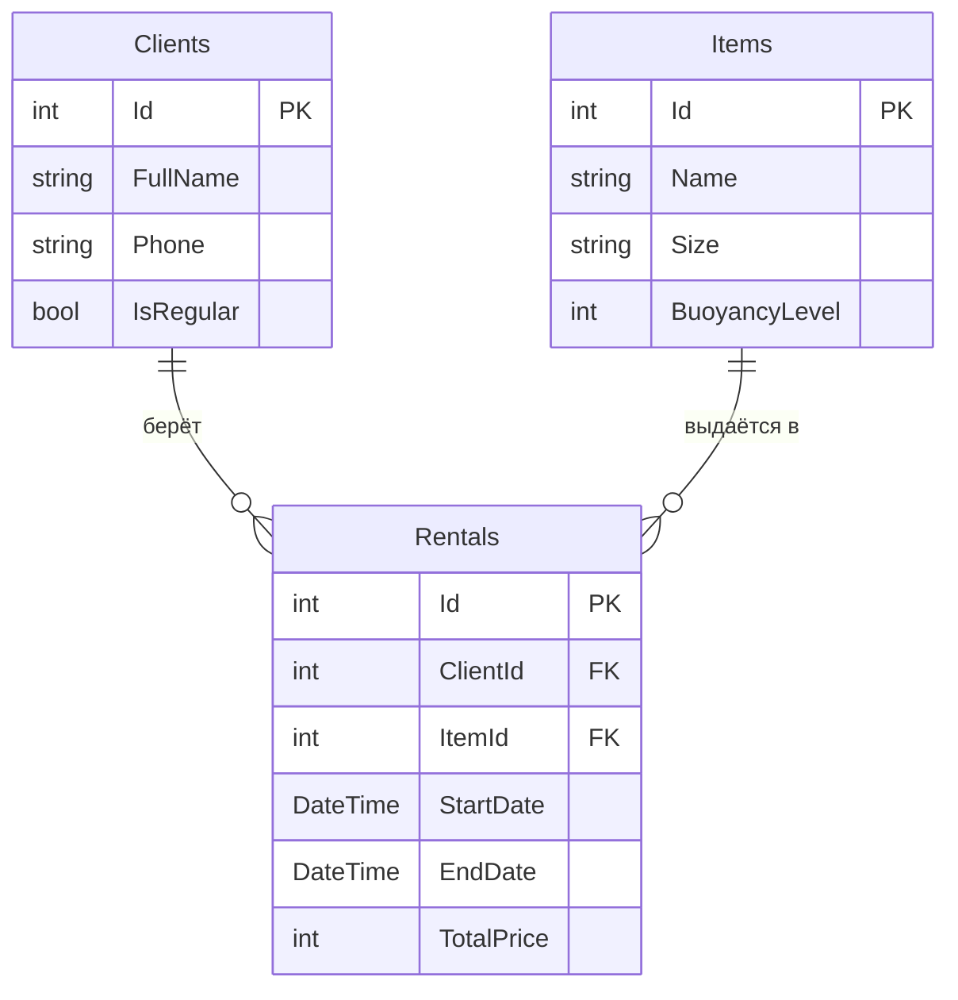

# WaveRent

Приложение для проката сапбордов и водного снаряжения на городском пляже.

## Автор

Лавришин М. в.

## О проекте

Прокат.

«Волна» — прокат сапбордов, гидрокостюмов и спасательного снаряжения на городском пляже.

«Волна» — это небольшой пункт проката на городском пляже, где любой желающий может взять сапборд, гидрокостюм или спасательный жилет на час или на целый день. Приложением пользуются сотрудники пункта: они оформляют выдачу снаряжения, отмечают возврат и видят, кто и что сейчас держит. От других прокатов «Волну» отличает то, что у каждой единицы снаряжения указан уровень плавучести и размер, а в аренде фиксируется время выдачи и возврата — так проще подобрать снаряжение под уровень клиента и не потерять вещи.

## Схема базы

## Таблицы

**Clients** — клиенты проката: кто берёт снаряжение и как с ним связаться.

| Поле | Тип | Обязательное | Описание |
|---|---|---|---|
| Id | int | да | Первичный ключ |
| FullName | string | да | ФИО клиента |
| Phone | string | да | Телефон для связи |
| IsRegular | bool | да | Постоянный клиент (скидка) |

**Items** — единицы снаряжения: что можно взять в прокат.

| Поле | Тип | Обязательное | Описание |
|---|---|---|---|
| Id | int | да | Первичный ключ |
| Name | string | да | Название (сапборд, гидрокостюм…) |
| Size | string | нет | Размер (S/M/L или объём в литрах) |
| BuoyancyLevel | int | да | Уровень плавучести 1–5 |

**Rentals** — аренды: кто, что и когда взял.

| Поле | Тип | Обязательное | Описание |
|---|---|---|---|
| Id | int | да | Первичный ключ |
| ClientId | int | да | Внешний ключ → Clients |
| ItemId | int | да | Внешний ключ → Items |
| StartDate | DateTime | да | Дата и время выдачи |
| EndDate | DateTime | нет | Дата и время возврата (null — ещё на руках) |
| TotalPrice | int | да | Стоимость аренды в рублях |

## Связи

Таблица **Rentals** связывает **Clients** и **Items** через внешние ключи `ClientId` и `ItemId`. Один клиент может брать много единиц снаряжения, а одну единицу снаряжения могут брать многие клиенты в разное время — поэтому связь «многие ко многим» реализована через связующую таблицу аренд.